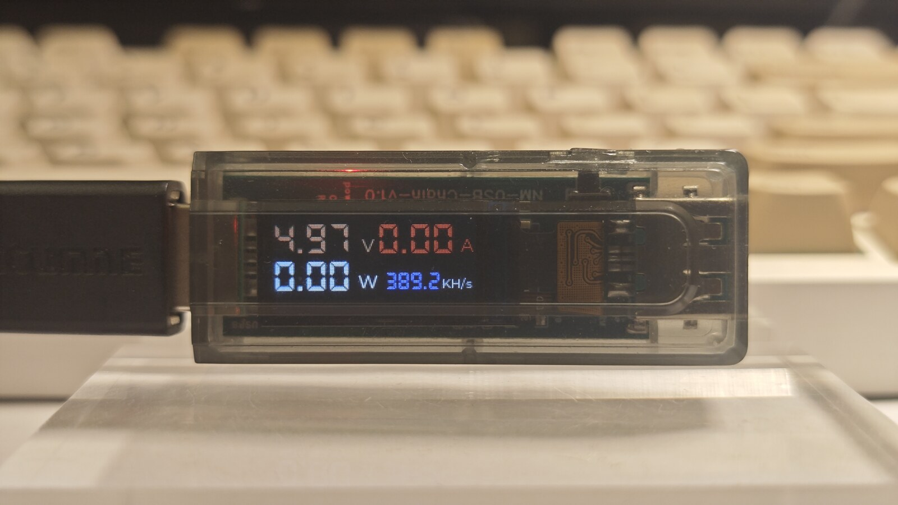
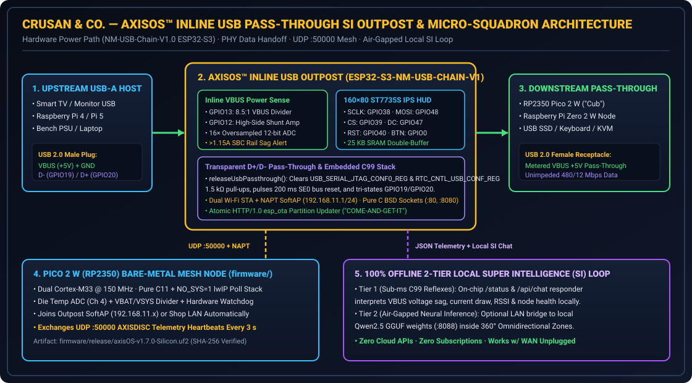

# -----------------------------------------------------------------------------
# File:        README.md
# Description: Official Landing Page & SDK Guide for Crusan & Co. AxisOS-Firmware
#              — Inline USB Pass-Through ESP32-S3 SI Outpost & Bare-Metal RP2350
#              (Pico 2 W) Micro-Squadron (Tindie x PCBWay 2026 Challenge Entry).
# Author:      Marc F. Crusan (MFC) / Crusan & Co. w/ PP & AGY (AXEL)
# Date:        2026111306
# Version:     v1.8.1-Silicon
# -----------------------------------------------------------------------------
# 2026111306 (MFC/AGY) Upgraded root landing page for Tindie x PCBWay 2026 AI Hardware Creative Challenge evaluation with ESP32-S3 Outpost SDK, physical prototype photo, SVG power/SI schematic, and full project report links.
# 2026110901 (MFC/PP/AGY) Upgraded from 2-line stub to full 5-Field SOP README with Crusan & Co. IP & Trademark notice.

# Crusan & Co. — AxisOS™ Inline USB Pass-Through SI Outpost & Bare-Metal Micro-Squadron
### **Official Project Repository · Tindie × PCBWay 2026 AI Hardware Creative Challenge**

[](https://axisos.pro)
[](esp32_s3_usb_outpost/AxisOS_ESP32_S3_USB_Outpost.ino)
[](firmware/CMakeLists.txt)
[](https://axisos.pro)

**Parent Enterprise:** **Crusan & Co.**  
**Flagship Platform:** **AxisOS™** (*U.S. Trademark Application Serial No. `99878469`*)  
**Lead Architect:** Marc F. Crusan  
**Website:** [https://axisos.pro](https://axisos.pro) · **Full Engineering Report:** [**`docs/TINDIE_PCBWAY_PROJECT_REPORT.md`**](docs/TINDIE_PCBWAY_PROJECT_REPORT.md)

---

## 🏆 Judge & Evaluator Quick-Jump Guide (Tindie × PCBWay 2026 Challenge)

Welcome evaluators! Everything required to review, verify, and reproduce my entry—the **AxisOS™ Inline USB Pass-Through SI Outpost & Bare-Metal Micro-Squadron**—is organized directly in this repository:

| Evaluation Area | Direct Repository Link | Summary of Ground-Truth Evidence |
| :--- | :--- | :--- |
| **1. Full Engineering Project Report** | [**`docs/TINDIE_PCBWAY_PROJECT_REPORT.md`**](docs/TINDIE_PCBWAY_PROJECT_REPORT.md) | Complete first-person engineering report covering real-world USB brownout & dead-zone problems, BOM, 2-Tier Offline SI integration, debugging case studies, and measured bench metrics |
| **2. Physical Prototype Hardware** | [**`docs/photos/nm_usb_chain_v1_inline_outpost.jpg`**](docs/photos/nm_usb_chain_v1_inline_outpost.jpg) | Real cased `ESP32-S3-NM-USB-CHAIN-V1` inline USB outpost measuring live `4.97 V / 0.00 A / 0.00 W` on its `160×80` `ST7735S` IPS color HUD |
| **3. Power, Pinout & Local SI Schematic** | [**`docs/hardware/inline_usb_power_and_si_architecture.svg`**](docs/hardware/inline_usb_power_and_si_architecture.svg) | Full vector schematic showing `GPIO13/12` `16×` VBUS sensing, `GPIO19/20` USB 2.0 PHY tri-state pass-through handoff, NAPT SoftAP repeater, `UDP :50000` mesh, and 2-Tier Local SI loop |
| **4. `ESP32-S3` Inline Outpost Firmware** | [**`esp32_s3_usb_outpost/AxisOS_ESP32_S3_USB_Outpost.ino`**](esp32_s3_usb_outpost/AxisOS_ESP32_S3_USB_Outpost.ino) | Self-contained C/C99 firmware: direct-register `ST7735S` `25.6 KB` SRAM HUD, `releaseUsbPassthrough()`, `1.15 A` SBC brownout sentry, onboard `/api/chat` SI console, and BSD-socket LAN OTA |
| **5. `RP2350` (`Pico 2 W`) Squadron SDK** | [**`firmware/`**](firmware/) | Pure C11 bare-metal `NO_SYS=1` `pico_cyw43_arch_lwip_poll` companion firmware (`CMakeLists.txt`, cooperative scheduler, die-temp/`VBAT` ADC HAL, watchdog, and `.uf2` builder) |



---

## 1. Elevator Pitch & Why I Built This on My Workbench

What if plugging a thumb-sized USB pass-through board into the back of a television, Raspberry Pi, laptop, or bench power supply instantly gave you real-time hardware VBUS power telemetry (`V / A / W`), a self-healing dual-stack Wi-Fi SoftAP repeater, and a standalone Super Intelligence (`SI`) web console that never phones home to a cloud server?

On my workbench at **Crusan & Co.**, single-board computers routinely hit silent `1.20 A` shared USB brownouts, edge microcontrollers sit just outside primary Wi-Fi reach, and commercial "AI gadgets" turn into bricks the moment you unplug the WAN cable. My family and I built the **AxisOS™ Inline USB Outpost (`ESP32-S3-NM-USB-CHAIN-V1`)** and its companion **`RP2350` (`Pico 2 W`) Micro-Squadron** around the Three Pillars of **AxisOS™**:

- **HONEST**: Live `16×`-oversampled hardware VBUS voltage/current/wattage sensing (`GPIO13` / `GPIO12`), `RP2350` silicon die-temperature ADC telemetry, CYW43439/ESP32 RSSI reporting, and early `1.15 A / 4.75 V` SBC brownout alerts—grounded in real hardware registers, never guesswork.
- **AUDITABLE**: Direct register-level `ST7735S` `160×80` SRAM framebuffer driver (`GPIO.out1_w1ts`/`out1_w1tc`), hardware register USB PHY release (`RTC_CNTL_USB_CONF_REG` / `USB_SERIAL_JTAG_CONF0_REG`) for clean downstream USB 2.0 `D+/D-` enumeration, and a cooperative `NO_SYS=1` lwIP C11 stack on the `RP2350`.
- **OWNED**: 2-Tier 100% Offline Local Super Intelligence (`< 1 ms` on-chip C99 hardware reflexes + optional air-gapped LAN bridge to local `Qwen2.5` GGUF weights on `:8088`) governed inside **360° Omnidirectional Zones** (`Green` / `Yellow` / `Red`), plus pure BSD-socket `COME-AND-GET-IT` LAN OTA updates with zero cloud brokers or subscriptions.



---

## 2. Repository Structure

| Path | Description |
| :--- | :--- |
| [`docs/TINDIE_PCBWAY_PROJECT_REPORT.md`](docs/TINDIE_PCBWAY_PROJECT_REPORT.md) | **Complete Tindie × PCBWay 2026 Engineering Report** (Problem, BOM, 2-Tier Local SI Loop, Pinouts, Debugging Case Studies & Validation Metrics) |
| [`docs/photos/nm_usb_chain_v1_inline_outpost.jpg`](docs/photos/nm_usb_chain_v1_inline_outpost.jpg) | Physical bench photo of the cased `ESP32-S3-NM-USB-CHAIN-V1` Inline USB Pass-Through Outpost (`4.97 V` live rail) |
| [`docs/hardware/inline_usb_power_and_si_architecture.svg`](docs/hardware/inline_usb_power_and_si_architecture.svg) | Vector hardware power, USB 2.0 PHY tri-state handoff, `UDP :50000` mesh, and 2-Tier Local SI architecture diagram |
| [`esp32_s3_usb_outpost/AxisOS_ESP32_S3_USB_Outpost.ino`](esp32_s3_usb_outpost/AxisOS_ESP32_S3_USB_Outpost.ino) | Complete public reference firmware for the `ESP32-S3-NM-USB-CHAIN-V1` Inline USB Outpost (`ST7735S` HUD, VBUS ADC, NAPT SoftAP, `/api/chat`, `AXISDISC` UDP, LAN OTA) |
| [`firmware/CMakeLists.txt`](firmware/CMakeLists.txt) | CMake build specification targeting `pico2_w` (`RP2350`) with `pico_cyw43_arch_lwip_poll` |
| [`firmware/config/axisOS_config.h`](firmware/config/axisOS_config.h) | Compile-time configuration defaults (Wi-Fi uplink, hardware watchdog intervals, GPIO pinout, OTA endpoint) |
| [`firmware/config/lwipopts.h`](firmware/config/lwipopts.h) | Bare-metal `NO_SYS=1` lwIP memory and TCP/UDP stack tuning |
| [`firmware/include/*.h`](firmware/include/) | Core status codes, HAL (`GPIO`, `ADC` die temp & `VBAT`, `I2C0`, `SPI0`), cooperative scheduler, and CYW43439 Wi-Fi headers (`v1.8.1-Silicon`) |
| [`firmware/src/*.c`](firmware/src/) | Pure C11 implementation modules (`main.c`, `axisOS_core.c`, `axisOS_hal.c`, `axisOS_tasks.c`, `axisOS_wifi.c`) |
| [`firmware/tools/build.sh`](firmware/tools/build.sh) | Automated toolchain & Pico SDK discovery build script generating `.uf2` images and `.sha256` digests |
| [`firmware/release/`](firmware/release/) | Pre-built `.uf2` reference images and `.sha256` verification digests |

---

## 3. Building & Flashing Both Boards

### 3.1 `ESP32-S3-NM-USB-CHAIN-V1` Inline USB Outpost (`esp32_s3_usb_outpost/`)

Hold the **`GPIO0` (`BOOT`)** button while inserting the Outpost into a USB port for initial flashing (during normal boot, `releaseUsbPassthrough()` disconnects the ESP32-S3's internal `D+/D-` PHY within `200 ms` so downstream USB 2.0 pass-through devices enumerate cleanly):

```bash
arduino-cli core install esp32:esp32
arduino-cli compile \
  --fqbn esp32:esp32:esp32s3:CDCOnBoot=cdc,FlashSize=8M,PartitionScheme=default \
  esp32_s3_usb_outpost/AxisOS_ESP32_S3_USB_Outpost.ino
arduino-cli upload -p /dev/ttyACM0 \
  --fqbn esp32:esp32:esp32s3:CDCOnBoot=cdc \
  esp32_s3_usb_outpost/AxisOS_ESP32_S3_USB_Outpost.ino
```

Once powered on any 5V USB port, join **`AXISOS-USB-OUTPOST-AP`** (`AxisOS-Setup-2026`) and browse to **`http://192.168.11.1/`** to use the onboard **Local SI Console** and save your Wi-Fi uplink credentials to NVS (`/wifi`).

### 3.2 `RP2350` (`Raspberry Pi Pico 2 W`) Companion Mesh Node (`firmware/`)

Ensure the **Raspberry Pi Pico SDK (`>= 2.0.0`)** and `arm-none-eabi-gcc` are installed, then run:

```bash
cd firmware
./tools/build.sh release
```

To pass custom Wi-Fi uplink credentials (such as pairing directly to the Outpost's `AXISOS-USB-OUTPOST-AP` repeater subnet) at compile time without modifying source headers:

```bash
cmake -B firmware/build -S firmware \
  -DPICO_BOARD=pico2_w \
  -DCMAKE_C_FLAGS="-DAXISOS_WIFI_SSID=\\\"AXISOS-USB-OUTPOST-AP\\\" -DAXISOS_WIFI_PASSWORD=\\\"AxisOS-Setup-2026\\\""
cmake --build firmware/build --parallel
```

---

## 4. Intellectual Property & Proprietary Core Exclusion Notice

> This repository provides the public reference SDK layer, inline `ESP32-S3` Outpost firmware, `RP2350` HAL interfaces, schematics, and bench validation artifacts for the **AxisOS™ Embedded Ecosystem** built by **Crusan & Co.** The underlying **AxisOS™ Native Bare-Metal Kernel** (`axisos-kernel.img`), the **freestanding C99 direct syscall userland** (`svc #0`), the **Sovereign Seven (`Sov-7`)** autonomous workstation daemon suite (`zero-core`, `axel-core`, `medona-core`, `lite`, `axis-agent`), `RAMGAK` deterministic memory bracket tooling, and production `AXIS_ROLE_MAYOR` mesh security keys are not distributed in this repository and remain the exclusive, proprietary intellectual property of **Crusan & Co.** (Marc F. Crusan).

**Copyright © 2026 Crusan & Co. (Marc F. Crusan). All Rights Reserved.**  
**AxisOS™** and **Julie™** are trademarks of **Crusan & Co.** (*U.S. Trademark Application Serial No. `99878469`*).
