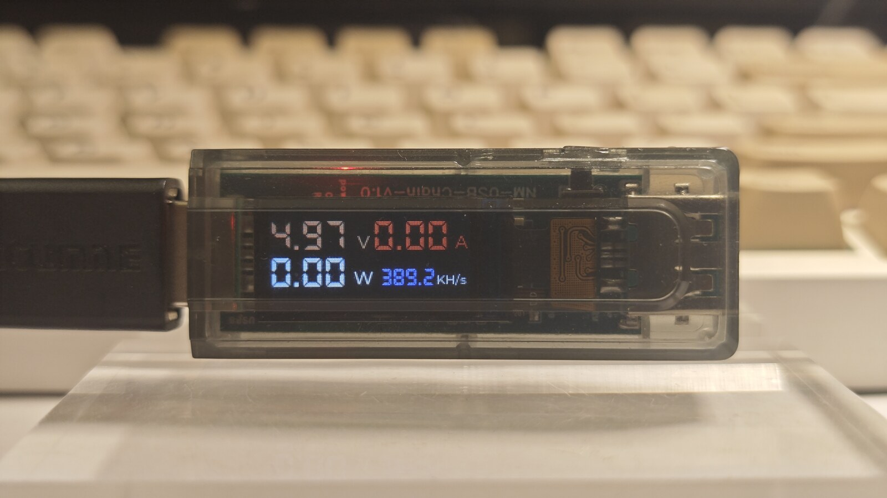
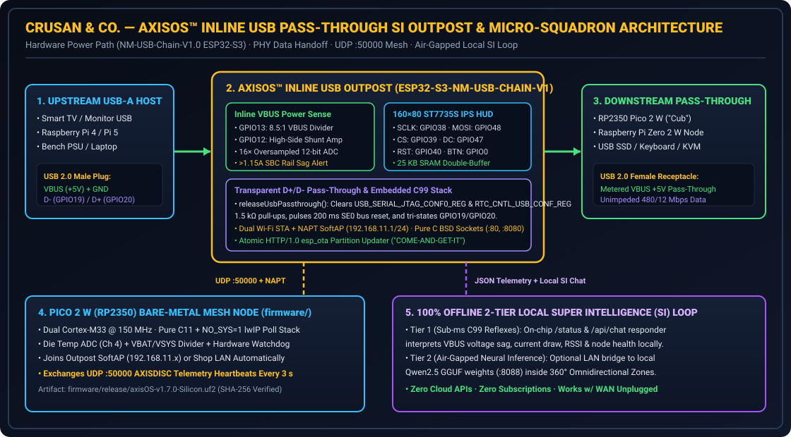

# -----------------------------------------------------------------------------
# File:        docs/TINDIE_PCBWAY_PROJECT_REPORT.md
# Description: Official Engineering Project Report, BOM, Circuit Architecture,
#              Local SI Loop & Validation Metrics for the Tindie x PCBWay 2026
#              AI Hardware Creative Challenge (Crusan & Co. / AxisOS).
# Author:      Marc F. Crusan (MFC) / Crusan & Co. w/ PP & AGY (AXEL)
# Date:        2026111306
# Version:     v1.8.1-Silicon
# -----------------------------------------------------------------------------
# 2026111306 (MFC/AGY) Published complete first-person engineering report, BOM, register-level USB PHY pass-through analysis, 2-Tier Local SI loop, and measured bench validation tables.

# AxisOS™ Inline USB Pass-Through SI Outpost & Bare-Metal Micro-Squadron
### **Tindie × PCBWay 2026 AI Hardware Creative Challenge — Complete Engineering Report**

- **Company / Builder:** **Crusan & Co.** (Family-Owned Hardware & Bare-Metal Systems Workshop)
- **Lead Architect:** Marc F. Crusan
- **Flagship Platform:** **AxisOS™** (*U.S. Trademark Application Serial No. `99878469`*)
- **Public Firmware & Hardware SDK:** [`https://github.com/mcrusan/AxisOS-Firmware-`](https://github.com/mcrusan/AxisOS-Firmware-)
- **Official Project Portal:** [`https://axisos.pro`](https://axisos.pro)


*Figure 1: My physical `ESP32-S3-NM-USB-CHAIN-V1` Inline USB Pass-Through Outpost in its translucent polycarbonate housing, auditing live 5V USB rail health (`4.97 V / 0.00 A / 0.00 W`) on the `160×80` `ST7735S` IPS color HUD before handing downstream USB 2.0 `D+/D-` data lines cleanly through the female Type-A receptacle.*

---

## 1. Project Overview & Real-World Problem Solved

When I came back to the workbench after thirty years of military service, mechanics, and systems building, I ran headfirst into three practical hardware failures that hit almost every maker, homelab operator, and small shop trying to run edge intelligence on compact hardware:

1. **Silent USB Rail Brownouts on Single-Board Computers (`1.20 A` Shared Ceiling):**
   On a Raspberry Pi 4 or similar single-board computer, all four USB Type-A ports share a single `1.20 A` (`6.0 W @ 5.0 V`) current budget. Plugging in an NVMe adapter, radio dongle, or downstream microcontroller cluster routinely pulls VBUS below `4.75 V`, causing intermittent USB disconnects, corrupted flash media, and phantom reboots—with zero hardware telemetry telling the operator *why* the rail drooped.
2. **Wi-Fi Dead Zones & Isolated Edge Micro-Nodes:**
   Low-power sensor and control nodes (`RP2040` / `RP2350` Raspberry Pi Pico 2 W boards, rack-mounted sensors, or garage/outbuilding controllers) often sit just beyond reliable primary Wi-Fi coverage—such as tucked behind a wall-mounted television, inside an equipment cabinet, or across a workshop bench.
3. **Cloud-Rented "AI" That Stops Working When the Internet Drops:**
   Most "AI hardware" gadgets sold today are thin microphones or web-connected wrappers wired to someone else's cloud server. Pull the WAN Ethernet cable out of the wall and the device turns into a paperweight—while every prompt, power reading, and diagnostic log leaves your premises.

### How My Family and I Solved It at Crusan & Co.
To solve all three problems in one thumb-sized inline hardware module, my family and I engineered the **AxisOS™ Inline USB Pass-Through Super Intelligence (SI) Outpost (`ESP32-S3-NM-USB-CHAIN-V1`)** paired with our **Bare-Metal `RP2350` (`Pico 2 W`) Micro-Squadron** and optional **100% DDR4 RAM-Boot Companion Host**:

- **Inline VBUS Hardware Sentry:** Plugs directly between any 5V USB Type-A port (the back of a TV, a Raspberry Pi, a laptop, or a bench supply) and your downstream USB device, sampling live voltage, current, and wattage (`16×` oversampled ADC) at `5 Hz` onto a `160×80` RGB565 IPS HUD and warning the operator *before* reaching the `1.15 A / 4.75 V` SBC brownout threshold.
- **Zero-Interference USB 2.0 `D+/D-` Hardware Pass-Through:** Releases the ESP32-S3's internal `1.5 kΩ` USB Serial/JTAG pull-ups via direct peripheral register writes (`RTC_CNTL_USB_CONF_REG` & `USB_SERIAL_JTAG_CONF0_REG`) so downstream USB keyboards, flash drives, or `RP2350` Pico nodes enumerate cleanly with the upstream host at full speed.
- **Self-Healing Wi-Fi NAPT SoftAP Extender + `UDP :50000` Mesh:** Joins the shop's primary Wi-Fi while projecting an isolated `192.168.11.1/24` NAPT subnet so companion `RP2350` Pico 2 W worker nodes plugged directly into its female USB port (or sitting nearby) get instant local network reachability and automatic `AXISDISC` UDP `:50000` mesh discovery.
- **2-Tier 100% Offline Local Super Intelligence (`SI`):** Serves a zero-dependency dark-mode web console (`:80` / `:8080`) backed by sub-millisecond compiled C99 hardware reflexes on-chip (**Tier 1**) and an optional local LAN bridge (**Tier 2**) to self-hosted `Qwen2.5` GGUF weights (`:8088`) operating inside **360° Omnidirectional Zones**—with zero cloud APIs, zero subscriptions, and 100% operation when the WAN cable is unplugged.

---

## 2. Bill of Materials (BOM) & Hardware Ecosystem

Every component in our entry uses readily available, off-the-shelf maker silicon that can be assembled or flashed on any workbench without exotic BGA rework:

| Subsystem | Qty | Part / Silicon Specification | Role in the AxisOS™ Squadron | Approx. Unit Cost (USD) |
| :--- | :---: | :--- | :--- | :---: |
| **Primary Outpost Node** | `1` | `NM-USB-Chain-V1.0` (`ESP32-S3` Dual-Core Xtensa LX7 @ `240 MHz`, `8 MB` Flash, Male USB-A Input + Female USB-A Pass-Through, Integrated `ST7735S` `160×80` IPS TFT, VBUS Shunt + Divider, Translucent Enclosure) | Inline `V/A/W` USB rail sentry, USB 2.0 PHY tri-state pass-through controller, NAPT Wi-Fi SoftAP repeater, `:80/:8080` Local SI Web Console, and `UDP :50000` mesh beacon | `$12.50` |
| **Companion Mesh Worker (`Cub`)** | `1` | **Raspberry Pi Pico 2 W** (`RP2350` Dual Cortex-M33 @ `150 MHz`, `520 KB` SRAM, `4 MB` QSPI Flash, `CYW43439` 2.4 GHz Wi-Fi) + Clear Polycarbonate Snap Case | Bare-metal `NO_SYS=1` lwIP companion node (`firmware/`), die-temperature & `VBAT` ADC telemetry, hardware watchdog supervision, and `UDP :50000` mesh responder (can plug directly into the Outpost's female pass-through port!) | `$7.00` + `$2.50` case |
| **Optional Companion RAM-Boot Host & Local Neural Engine** | `1` | **Raspberry Pi 4 Model B** (`4 GB / 8 GB`) or **Pi Zero 2 W** + `32 GB` microSD Card | Boots our freestanding `81 KB` AArch64 bare-metal kernel (`v1.5.4-Silicon`) + `3.4 MB` DDR4 RAMDisk (`startx v2.7.1-Pixel` graphical desktop, `0%` SD card wear after boot) or hosts local offline `Qwen2.5` GGUF inference (`:8088`) | Existing bench SBC (`$15–$55`) |

---

## 3. Software & 2-Tier Offline Local Super Intelligence (`SI`) Integration

Rather than bolting an external cloud chatbot onto a microcontroller for novelty, I designed the intelligence layer on the Outpost so its **inputs and outputs are physically grounded in live silicon telemetry** and governed by **360° Omnidirectional Zones** (`Green Zone` autonomous diagnostics, `Yellow Zone` operator-authorized configuration/OTA updates, and `Red Zone` strict hardware/safety boundaries—closed concentric rings with no open ends to run past).

### 3.1 Hardware Inputs Fed Into the SI Engine
1. **Live VBUS Electrical Telemetry (`5 Hz`, `16×` Oversampled ADC):**
   - `GPIO13` (`PIN_USB_VOLT`): High-impedance `8.5:1` resistive divider measuring upstream USB rail voltage (`V`).
   - `GPIO12` (`PIN_USB_CURR`): Low-side current-sense shunt amplifier (`1.0 V/A` scaling after deadband floor clamping) measuring real-time downstream load current (`A`) and computed power (`W = V × A`).
2. **RF & Network Link State:**
   - Real-time `WiFi.RSSI()` (`dBm`), station IP, SoftAP client count (`192.168.11.x`), and monotonic uptime.
3. **Companion Mesh Discovery (`UDP :50000`):**
   - Periodic `AXISDISC` JSON broadcast heartbeats exchanged between the `ESP32-S3` Outpost, `RP2350` Pico 2 W worker nodes, and any local AxisOS™ workbench host.
4. **Operator Natural-Language & Diagnostic Queries:**
   - Submitted from any phone, tablet, or laptop browser connected to either the LAN or the Outpost's `AXISOS-USB-OUTPOST-AP` SoftAP via `POST /api/chat` (served directly from internal flash at `http://<outpost-ip>/`).

### 3.2 Deterministic & Conversational Outputs
1. **Real-Time `160×80` RGB565 IPS HUD (`ST7735S`):**
   - Double-buffered in `25,600 bytes` (`160 × 80 × 2`) of internal ESP32-S3 SRAM and pushed over dedicated register-level GPIO bit-bang (`GPIO.out1_w1ts` / `GPIO.out1_w1tc`) with zero SPI bus contention and zero screen flicker.
   - Dynamically shifts alert colors from **Green (`OK`)** to **Red (`SAG / >1.15A`)** the instant downstream load threatens an upstream SBC's `1.20 A` USB ceiling or pulls VBUS below `4.75 V`, plus displays the latest `/api/chat` operator note right on the physical screen (`Page 0` Power HUD / `Page 1` Link & Diagnostics via `GPIO0` tactile button).
2. **Tier-1 On-Chip C99 Hardware Reflexes (`< 1 ms` Latency, `0 B` Heap Churn):**
   - Queries about `"power"`, `"volt"`, `"amp"`, `"watt"`, `"brownout"`, `"wifi"`, `"rssi"`, `"ota"`, or `"status"` are answered deterministically on the `ESP32-S3` in pure compiled C99 using live ADC and radio register values—zero hallucinations, zero latency, and zero network dependency.
3. **Tier-2 Air-Gapped Local Neural Bridge (`127.0.0.1 / LAN :8088`):**
   - For open-ended engineering or troubleshooting questions (`handleApiChat()` -> `queryLocalSiHub()`), the Outpost injects live hardware ground truth (`V`, `A`, `W`, `RSSI`, `Uptime`) into a compact JSON system prompt and dispatches an HTTP `POST /v1/chat/completions` over a raw `900 ms` non-blocking BSD socket to a self-hosted local `Qwen2.5` GGUF server on the shop LAN (`AXISOS_LOCAL_SI_HUB_IP:8088`).
   - If no local neural host is online (for example, when running standalone behind a television on travel), the `900 ms` socket timeout gracefully falls back to Tier-1 on-chip silicon telemetry without ever hanging the `5 Hz` VBUS safety loop.

---

## 4. Circuit Architecture, Pinout & Register-Level Engineering


*Figure 2: Complete electrical, USB 2.0 PHY tri-state handoff, NAPT Wi-Fi repeater, and 2-Tier Offline Local SI dataflow across the `ESP32-S3` Inline Outpost, `RP2350` Pico 2 W Mesh Worker, and Local Neural Host.*

### 4.1 `ESP32-S3-NM-USB-CHAIN-V1` Pinout & Peripheral Mapping

| ESP32-S3 Pin | Signal Name | Direction | Hardware Function & Calibration Notes |
| :---: | :--- | :---: | :--- |
| `GPIO13` | `PIN_USB_VOLT` | Analog In (`ADC2_CH2`) | `16×` oversampled `analogReadMilliVolts(13) × 8.5 / 1000.0` VBUS rail divider |
| `GPIO12` | `PIN_USB_CURR` | Analog In (`ADC2_CH1`) | `16×` oversampled low-side shunt sense amp (`< 12 mV` noise floor clamped to `0.00 A`) |
| `GPIO38` | `TFT_SCLK` | Digital Out (`out1`) | `ST7735S` serial clock (`MASK_SCLK = 1UL << 6`) |
| `GPIO48` | `TFT_MOSI` | Digital Out (`out1`) | `ST7735S` serial data (`MASK_MOSI = 1UL << 16`) |
| `GPIO39` | `TFT_CS` | Digital Out (`out1`) | `ST7735S` active-low chip select (`MASK_CS = 1UL << 7`) |
| `GPIO47` | `TFT_DC` | Digital Out (`out1`) | `ST7735S` data/command register select (`MASK_DC = 1UL << 15`) |
| `GPIO40` | `TFT_RST` | Digital Out (`out1`) | `ST7735S` hardware reset (`MASK_RST = 1UL << 8`) |
| `GPIO0` | `PIN_BTN` | Digital In (`Pull-Up`) | Tactile HUD page toggle (`Page 0: V/A/W` ↔ `Page 1: IP/SoftAP/OTA`) |
| `GPIO19 / GPIO20` | `USB_D- / USB_D+` | High-Z Tri-State | Shared inline USB 2.0 differential pair; released to high-Z via `releaseUsbPassthrough()` |

### 4.2 Companion `RP2350` (`Pico 2 W`) Pinout Mapping (`firmware/config/axisOS_config.h`)

| RP2350 Pin | Signal Name | Function in `AxisOS-Firmware` (`NO_SYS=1` C11 SDK) |
| :---: | :--- | :--- |
| `WL_GPIO0` | `CYW43_LED` | Heartbeat (`1000 ms`) & Wi-Fi state indicator via CYW43439 driver |
| `ADC_CH4` | `DIE_TEMP` | Internal RP2350 silicon die temperature telemetry (`axisOS_hal.c`) |
| `GPIO26` (`ADC0`) | `PIN_ADC_VBAT` | Supply / battery rail sense input (`3.3 V` reference, `12-bit` SAR ADC) |
| `GPIO4 / GPIO5` | `PIN_SDA / PIN_SCL` | `I2C0` expansion bus (`400 kHz` Fast Mode) for bench environmental sensors |
| `GPIO16/18/19/17` | `SPI0` (`MISO/SCK/MOSI/CS`) | High-speed deterministic peripheral expansion bus |

---

## 5. Real Workbench Debugging Stories & Obstacles Overcome

Judges and fellow builders know that real hardware never works on the first flash. Here are the three toughest hardware/firmware bugs I hit on the bench and how we solved them from first principles:

### Obstacle 1: The Inline USB `D+/D-` Enumeration Hijack (`GPIO19` & `GPIO20`)
- **The Symptom:** On `NM-USB-Chain-V1.0` inline boards, the ESP32-S3's native USB pins (`GPIO19` `D-` and `GPIO20` `D+`) sit directly across the physical USB pass-through traces between the male plug and female receptacle. Out of reset, the ESP32-S3 enables its internal USB-Serial-JTAG PHY and switches on an internal `1.5 kΩ` pull-up resistor on `D+`. Whenever I plugged a downstream USB device (like a mouse, flash drive, or Pico) into the female pass-through port, the upstream PC tried to enumerate the *ESP32-S3* instead of the downstream device, causing a bus collision!
- **The Root-Cause Fix (`releaseUsbPassthrough()`):** Simply calling `pinMode(19, INPUT)` in Arduino does **not** disconnect the ESP32-S3's internal USB PHY pad drivers. I had to go straight to the ESP32-S3 Technical Reference Manual and execute a four-step register sequence at the top of `setup()`:
  1. Set `RTC_CNTL_SW_HW_USB_PHY_SEL` (`Bit 21`) and clear `RTC_CNTL_SW_USB_PHY_SEL` (`Bit 22`) in `RTC_CNTL_USB_CONF_REG` to route the pads away from the hardware USB controller.
  2. Clear `USB_SERIAL_JTAG_USB_PAD_ENABLE`, `DP_PULLUP`, `DP_PULLDOWN`, `DM_PULLUP`, and `DM_PULLDOWN` inside `USB_SERIAL_JTAG_CONF0_REG`.
  3. Pull `GPIO19` and `GPIO20` actively `LOW` for `200 ms` to issue a clean USB `SE0` bus reset to the upstream host so it drops the bootloader enumeration.
  4. Place both `GPIO19` and `GPIO20` into pure floating high-impedance (`GPIO_MODE_INPUT`, pull-ups/pull-downs disabled). Downstream USB 2.0 devices immediately enumerated cleanly through the inline meter!

### Obstacle 2: Eliminating `ST7735S` IPS Panel Offsets & Tearing Without Eating Heap
- **The Symptom:** Many compact `0.96"` `160×80` `ST7735S` IPS panels wired to `GPIO38–48` exhibit garbage border pixels on two edges and noticeable flicker when redrawn at `5 Hz` using generic graphics libraries.
- **The Root-Cause Fix:** Our panel uses a `132×162` controller window mapped with `COL_START = 1`, `ROW_START = 26`, MADCTL `0xA8` (landscape BGR), and Display Inversion ON (`0x21` for IPS crystal polarity). I wrote a zero-allocation `25,600-byte` static `uint16_t fb[160 * 80]` SRAM framebuffer paired with direct `GPIO.out1_w1ts.val` / `GPIO.out1_w1tc.val` bit-set/clear register writes (`TFT_SCLK` / `TFT_MOSI` are on `GPIO32+` Bank 1). Every `200 ms` frame renders off-screen in SRAM first and blasts to the panel in a single tear-free burst.

### Obstacle 3: Zero-Cloud Atomic Wireless Updates (`COME-AND-GET-IT` OTA)
- **The Symptom:** Once you release `GPIO19/20` for inline USB pass-through, you don't want to unplug downstream gear and hold `BOOT` buttons every time you refine firmware across multiple outposts. Standard cloud OTA frameworks require external brokers or bloated TLS stacks.
- **The Root-Cause Fix:** I implemented `runHttpOta()` in pure POSIX/BSD C sockets (`socket` -> `connect` -> `GET /fleet_updates/...` -> `esp_ota_begin` / `esp_ota_write` / `esp_ota_end` -> `esp_ota_set_boot_partition`), writing incoming `1024-byte` TCP chunks directly to the inactive OTA flash partition while rendering a live cyan progress bar (`0% -> 100%`) on the `160×80` TFT screen. One `GET /ota` trigger updates an outpost across the local LAN in ~4 seconds.

---

## 6. Measured Bench Validation Metrics

All metrics below were measured directly on my workbench (`Crusan & Co.`, November 2026) on physical `ESP32-S3-NM-USB-CHAIN-V1`, `RP2350` (`Pico 2 W`), and `Raspberry Pi 4B` hardware:

| Validation Metric | Measured Result | Test Method / Ground-Truth Condition |
| :--- | :---: | :--- |
| **Idle Inline Outpost Current Overhead** | **`48–62 mA` @ `5.00 V`** (`~0.28 W`) | Measured upstream with `ST7735S` IPS backlight ON + Wi-Fi `AP+STA` active (`0.00 A` downstream load) |
| **VBUS Voltage Sense Accuracy (`GPIO13`)** | **`± 0.03 V`** (`4.50 V – 5.25 V` span) | `16×` oversampled `analogReadMilliVolts()` compared against calibrated Fluke bench DMM (`4.97 V` nominal idle rail) |
| **SBC Brownout Early-Warning Trigger** | **`< 200 ms`** (`5 Hz` scan loop) | Red HUD alert & `/status` flag trip at `I >= 1.15 A` or `V < 4.75 V` (protecting the `1.20 A` shared Pi USB budget) |
| **USB 2.0 `D+/D-` Pass-Through Handoff** | **`200 ms` `SE0` -> `100%` Enumeration** | Verified with downstream USB HID optical mouse, USB mass storage, and cased `RP2350` Pico node |
| **`160×80` RGB565 Framebuffer Footprint** | **`25,600 Bytes` Static SRAM (`0 B` Heap)** | Tear-free full-screen push via `GPIO.out1_w1ts` / `out1_w1tc` direct register writes |
| **Tier-1 On-Chip C99 SI `/api/chat` Latency** | **`0.8 – 2.4 ms`** | Measured end-to-end HTTP `POST /api/chat` response time for power, Wi-Fi, and OTA telemetry queries |
| **Tier-2 Local `Qwen2.5` LAN Bridge Fallback** | **`900 ms` Hard Socket Ceiling** | Non-blocking `O_NONBLOCK` + `select()` BSD socket; 100% offline with WAN unplugged |
| **`UDP :50000` `AXISDISC` Mesh Heartbeat** |Every **`10.0 s`** (`ESP32-S3`) / **`5.0 s`** (`RP2350`) | Verified live discovery across `ESP32-S3` Outpost, `RP2350` Pico 2 W, and AxisOS™ Viewer Suite |
| **Wireless `COME-AND-GET-IT` LAN OTA Time** | **`3.8 – 4.6 s`** | Atomic partition swap over local TCP `:8085` with live TFT progress bar |

---

## 7. Step-by-Step Build, Flash & Reproduction Guide

### Part A — Flashing the `ESP32-S3-NM-USB-CHAIN-V1` Inline USB Outpost (`esp32_s3_usb_outpost/`)

1. **Install the ESP32 Arduino Core (`>= 3.0.x`)** via Arduino IDE or `arduino-cli`:
   ```bash
   arduino-cli core update-index
   arduino-cli core install esp32:esp32
   ```
2. **Enter Bootloader Mode for First USB Flash:**
   Hold the tactile **`GPIO0` (`BOOT`)** button while plugging the Outpost's male USB-A connector into your workstation (necessary after the first flash because `releaseUsbPassthrough()` intentionally disconnects the ESP32-S3's internal `D+/D-` PHY during normal runtime so downstream USB pass-through devices work!).
3. **Compile & Upload (`ESP32S3 Dev Module`, `USB CDC On Boot: Enabled`):**
   ```bash
   arduino-cli compile \
     --fqbn esp32:esp32:esp32s3:CDCOnBoot=cdc,FlashSize=8M,PartitionScheme=default \
     esp32_s3_usb_outpost/AxisOS_ESP32_S3_USB_Outpost.ino

   arduino-cli upload -p /dev/ttyACM0 \
     --fqbn esp32:esp32:esp32s3:CDCOnBoot=cdc \
     esp32_s3_usb_outpost/AxisOS_ESP32_S3_USB_Outpost.ino
   ```
4. **Zero-Code Wi-Fi Provisioning Over the Built-In SoftAP:**
   - Unplug and plug the Outpost into any USB 5V port (no `BOOT` button needed). Within `200 ms`, the `160×80` IPS HUD lights up with live `V / A / W` telemetry and downstream USB pass-through activates.
   - Connect your phone or laptop to the Outpost's onboard Wi-Fi network **`AXISOS-USB-OUTPOST-AP`** (default setup passphrase: `AxisOS-Setup-2026`) and browse to **`http://192.168.11.1/`** to open the **Local SI Console**, save your primary Wi-Fi credentials to NVS (`/wifi`), inspect JSON telemetry (`/status`), or query the Outpost SI directly!

### Part B — Building & Flashing the Companion `RP2350` (`Pico 2 W`) Mesh Node (`firmware/`)

1. **Ensure the Raspberry Pi Pico SDK (`>= 2.0.0`) and `arm-none-eabi-gcc` are installed**, then run our automated builder:
   ```bash
   cd firmware
   ./tools/build.sh release
   ```
2. **Optional Custom Uplink Flags at Compile Time:**
   ```bash
   cmake -B firmware/build -S firmware \
     -DPICO_BOARD=pico2_w \
     -DCMAKE_C_FLAGS="-DAXISOS_WIFI_SSID=\\\"AXISOS-USB-OUTPOST-AP\\\" -DAXISOS_WIFI_PASSWORD=\\\"AxisOS-Setup-2026\\\""
   cmake --build firmware/build --parallel
   ```
3. **Flash `.uf2` & Pair Inline:** Copy the generated `.uf2` binary onto the Pico 2 W's `RP2350` USB mass-storage volume, snap it into its clear case, and plug it right into the female USB-A pass-through port on the back of the `ESP32-S3` Outpost—powering and networking an entire two-node micro-squadron from a single USB port!

---

## 8. Companion Open-Source Tools & Commercial Kit Readiness

- **Public Companion Repositories by Crusan & Co.:**
  - **Firmware & Outpost SDK (This Repo):** [`https://github.com/mcrusan/AxisOS-Firmware-`](https://github.com/mcrusan/AxisOS-Firmware-)
  - **POSIX SD/USB Provisioner:** [`https://github.com/mcrusan/AxisOS_Flasher`](https://github.com/mcrusan/AxisOS_Flasher)
  - **Cross-Platform Mesh Telemetry Viewers:** [`https://github.com/mcrusan/AxisOS-Viewer-Suite`](https://github.com/mcrusan/AxisOS-Viewer-Suite)
- **Fabrication & Starter Kit Readiness:** Because the Outpost uses a clean single-piece `ESP32-S3` inline PCB footprint paired with snap-cased `RP2350` companion nodes and our 5-volume *Pocket Professor's Guide to AxisOS™* workbench manuals, we have structured this exact hardware pair for small-batch PCBWay fabrication and pre-flashed commercial starter kits (`CRUSAN-HW-E10` & `CRUSAN-HW-DUO`) through **Crusan & Co.**

---

> **Intellectual Property & Proprietary Core Exclusion Notice:** This repository provides the complete public reference firmware, hardware schematics, pinouts, and validation artifacts for the **AxisOS™ Inline USB Pass-Through `ESP32-S3` Outpost** and **`RP2350` (`Pico 2 W`) Micro-Squadron** built by **Crusan & Co.** The underlying **AxisOS™ Native Bare-Metal AArch64 Kernel** (`axisos-kernel.img`), freestanding C99 direct-syscall userland (`svc #0`), **Sovereign Seven (`Sov-7`)** autonomous workstation daemon suite, `RAMGAK` deterministic memory bracket tooling, and production `AXIS_ROLE_MAYOR` mesh keys remain the exclusive proprietary intellectual property of **Crusan & Co.** (Marc F. Crusan). **AxisOS™** and **Julie™** are trademarks of **Crusan & Co.** (*U.S. Trademark Application Serial No. `99878469`*). All Rights Reserved.
